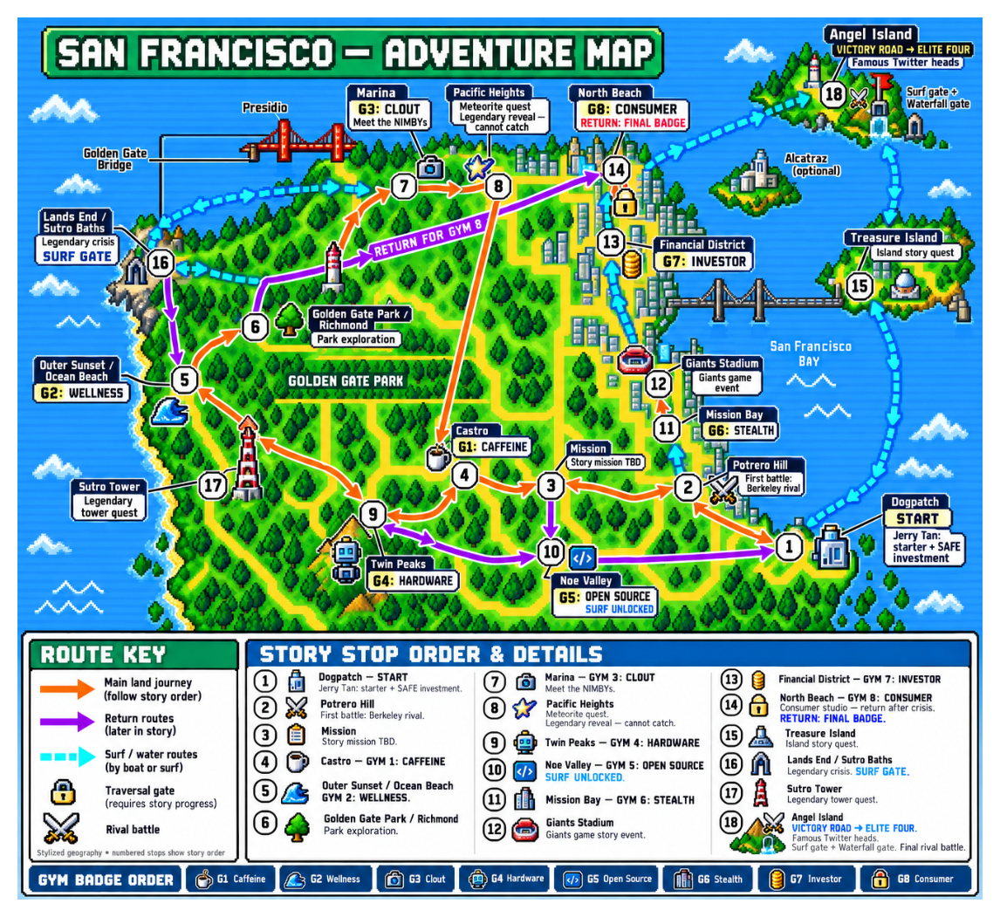

# SF Mini Monsters

An open-source San Francisco creature RPG and Emerald ROM hack for GBA and web.

[Play the world preview](https://sf-mini-monsters.devkunjadia03.chatgpt.site/world) ·
[v80 Sunset preview](https://sf-mini-monsters.devkunjadia03.chatgpt.site/) ·
[Game spec and progress](docs/game-spec.md#15-active-emerald-parity-goal) ·
[Development agent](DEVELOPMENT_AGENT.md) · [Build a gym or mission](CONTRIBUTING.md)

## Current development goal: finish the compact SF world

The v88 world preview has 18 compact destinations, 19 connectors, eight
reserved gym rooms and 13 small service interiors. Urban areas use dense attached
blocks, original SF landmark candidates, authored residents and safe walkers.
Parks, coasts and both islands have distinct trails and scenery. An in-game SF
map shows all destinations and their actual connections. The next pass improves
its geography and readability, then continues district/route/interior finishing.

All 18 local activities have passed native reward/revisit checks. The 58-map
controller circuit, earlier land/Surf save upgrades and original-resource audits
pass on their recorded draft builds. These are functional checks, not final town
or art approval. The latest v88 candidate completed a full105,935-frame native/WASM route with
byte-identical guest RAM. Actual browser patch/import/cold Continue displays its
new architecture and paint; earlier30-second smoke samples remain separate. The longer browser-session issue and human quality review remain open.
See the [generation guide](docs/world/generation.md) and the current
[spec checkpoints](docs/game-spec.md#151-objective-and-completion-rule).
The existing root website preview stays v80. The separate `/world` exploration
preview is live with the tested v88 cartridge, its own save slot and
temporary access stamps. Final gym battles, contributor missions and human
town-quality acceptance remain unfinished.

The [editable Excalidraw plan](docs/world/initial-world-plan.excalidraw),
[interpretation and open decisions](docs/world/plan-notes.md), and
[world manifest](romhack/world/world.json) are the working inputs. The previous
[story treatment](docs/story/README.md) is retained as a historical draft; the
new Dogpatch route supersedes its Sunset-first route for this blockout.

This illustration is a planning concept, not the current playable map. The newer
editable scene has differences documented in the plan notes. Both islands are
approved: Treasure Island for its quest and Angel Island for the League, the
sole exception to the SF-city-limits rule.

| Gym | Theme | Planned area |
| --- | --- | --- |
| 1 | Caffeine | Castro |
| 2 | Wellness | Outer Sunset |
| 3 | Clout | Marina |
| 4 | Hardware | Twin Peaks |
| 5 | Open Source | Noe Valley |
| 6 | Stealth | Mission Bay |
| 7 | Investor | Financial District |
| 8 | Consumer Agents | North Beach / Jackson Square |

Contributors can own individual gyms and story events through focused PRs. The
[module index](romhack/modules/README.md) contains eight gym and six mission
packages, each with a handoff, agent instructions, reserved state and local tests.
The [repo-local skill](.agents/skills/sf-module/SKILL.md) guides an agent through
implementation, private GBA/web playtests and owner review. Shared routes,
progression and exits stay with the core game. All slots remain unassigned.

## What is playable now

The [world preview](https://sf-mini-monsters.devkunjadia03.chatgpt.site/world)
is **v0.0.89**: all 18 destinations and their routes, residents, local activities,
small service interiors, city guide and eight reserved gym sites. The loan
creature and gym access stamps are development tools. Final encounters, story
missions, balance and human world-quality acceptance remain open.

The default root preview is **v0.0.80**: Outer Sunset, Muni to SoMa/South Park, clinic,
courier apartment, Seed Room and the first Cognition gym draft, with eighteen
original creature candidates and three starter evolution lines. It is unfinished;
the new Dogpatch world and diagram's themed gyms are not yet implemented there.

Players supply the supported Emerald .gba or ZIP. The website patches it locally;
ROM bytes stay on the player's device. The resulting cartridge can be downloaded
for a standard GBA emulator. [World patch](https://sf-mini-monsters.devkunjadia03.chatgpt.site/world-patch/sf-mini-monsters.bps) ·
[v80 patch](https://sf-mini-monsters.devkunjadia03.chatgpt.site/patch/sf-mini-monsters.bps).

World generation uses a separate draft profile and save identity. Keep v80 saves
backed up; do not assume a new starting map is a compatible continuation.
The [earlier standalone prototype](https://sf-mini-monsters.devkunjadia03.chatgpt.site/prototype)
is an archived experiment.

## Development and acceptance

Read [AGENTS.md](AGENTS.md) and [DEVELOPMENT_AGENT.md](DEVELOPMENT_AGENT.md).
The immediate proof is actual traversal on the same GBA ROM in native mGBA and
the web emulator, deterministic generation, valid arrivals/connections, no
unreachable required area, and safe returns at each traversal stage. A graph or
renamed stock map alone does not satisfy the world-generation goal.

See [native build/patch workflow](romhack/README.md) and
[controls, save transfer and QA](docs/testing.md). Original map data and scripts
are compiled into the cartridge. The web wrapper uses React/Vinext and Sites;
there is no cloud-save database. Guest and signed-in device-local saves are separate.

Commit coherent changes frequently, around 200–300 code lines where practical.
Use local checks, preserve unrelated work and keep GitHub Actions manual-only.
Do not publish commercial ROMs or private saves. Publication of a new blockout
is a separate reviewable release; the existing preview remains available.

## Longer-term game scope

The larger game still targets 150 collectible mini monsters, starter evolution
lines, recurring rivals, Team NIMBY/story events, eight gyms, a championship,
a legendary quest, SF jokes/lore, Marina bars, optional drunk/high play and dates.
The [spec](docs/game-spec.md) records acceptance and remaining production work.
World-blockout completion is not full campaign completion or Emerald-quality approval.
Later cast additions remain modular, researched content.

## Licensing and originality

Original code/documentation use [MIT](LICENSE). Original generated sprite atlases
are offered under CC BY 4.0 to the extent licensable; see [asset credits](assets/README.md).
User-supplied planning images are attributed as such. Dependencies and inherited
commercial engine/assets retain their own rights; our license does not relicense them.

Publish original SF sources, tools and approved versioned patches. Keep commercial
and reconstructed full cartridges in ignored local storage. Players provide their
own validated base ROM. See [mGBA](https://github.com/mgba-emu/mgba) and the pinned
[Emerald workflow](romhack/README.md) for platform/build context.
